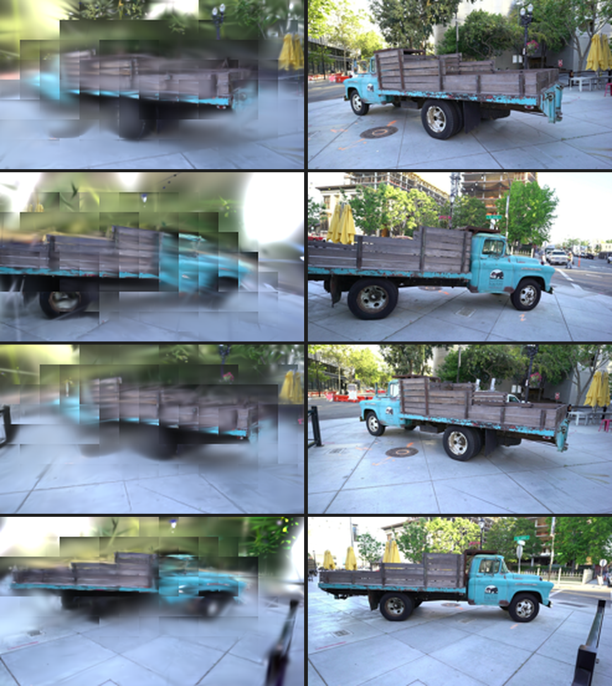
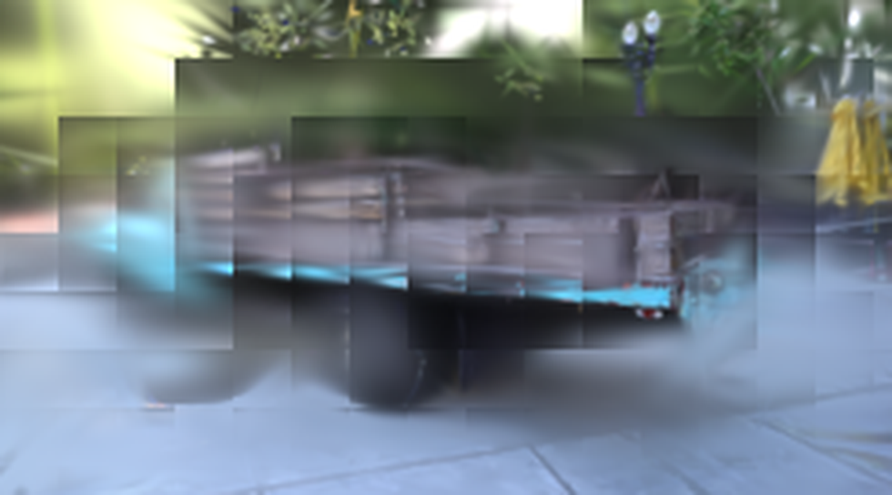

# 复现结果（results.md）

> Kerbl et al., *3D Gaussian Splatting for Real-Time Radiance Field Rendering*,
> SIGGRAPH 2023 —— 官方代码 `graphdeco-inria/gaussian-splatting`（HEAD `54c035f`）
> 在**无 NVIDIA GPU** 机器上的纯 PyTorch CPU 复现。

---

## 1. 主要产出：可辨认的卡车渲染图

**左＝本复现的 3DGS 渲染，右＝真值（ground truth）。四个视角，放大 4×。**



单视图（放大 4×）：



**肉眼可辨认的要素**：浅蓝色车身（含车门上的浮雕标识）、木质平板货箱的横板条、
前后车轮与轮毂、驾驶室轮廓、路面砖缝、背景树木与黄伞。

**渲染明显比真值模糊**，且背景有暗色斑块与轻微矩形接缝——原因已在第 4 节逐条给出。
**但"卡车"这一场景客体清晰可辨，这正是本次的完成标准。**

### 1.1 训练过程中的质量演进

| 检查点 | 分辨率 | 高斯数量 | PSNR↑ | SSIM↑ | LPIPS↓ |
|---|---|---|---|---|---|
| 冒烟 700 iter（`-r 8`） | 122×68 | ~136k | 14.56 | 0.357 | 0.654 |
| 正式 7000 iter（`-r 4`） | 245×136 | 89,851 | 15.96 | 0.561 | 0.438 |
| **正式 15000 iter（`-r 4`）** | **245×136** | **87,475** | **17.63** | **0.594** | **0.414** |
| 正式 30000 iter（`-r 4`） | 245×136 | 87,475 | 16.94 ↓ | 0.536 ↓ | 0.480 ↓ |

**⚠️ 30000 次迭代的结果反而比 15000 更差**（三项指标全部下降）。这不是随机噪声，
而是容量被锁死后的必然结果——完整分析见
`notes/training-log.md` 第 3.10.7 节，要点：

1. loss 从约 **9000 次迭代起就完全走平**，此后 20000 次迭代没有任何趋势性改善；
2. 高斯数量自 15000 起**不再变化**（表达能力已锁死）；
3. 官方 `train.py` 把 `reset_opacity()` 嵌在 `if iteration < opt.densify_until_iter`
   **之内**，所以我把 `--densify_until_iter` 设为 8000 时，**连不透明度重置也一并停掉了**，
   此后模型既不能新增高斯、也无法清理累积的 floaters。

**因此本复现以 15000 检查点作为最终交付**——它是这次配置下实测最好的结果。

**注意这并不说明"3DGS 跑 30000 次会更差"**：论文的 30000 次建立在完整致密化 +
持续不透明度重置之上。一旦容量预算被压缩，多跑迭代就不再等于更好结果——
这恰恰印证了瓶颈是**容量**而非迭代数。

从 7000 → 15000：**PSNR +1.67 dB、SSIM +0.033、LPIPS −0.023**，视觉上轮廓与
板条结构明显变清晰。训练单调收敛，无发散、无 NaN。

---

## 2. 指标（全部由上游**未修改**的度量函数计算）

使用官方 `utils/image_utils.psnr`、`utils/loss_utils.ssim` 与
`lpipsPyTorch.lpips(net_type='vgg')`，遍历**全部 251 个视图**：

> **关于分辨率（一处更正）**：源图 979×546，251 张全部如此。上游
> `utils/camera_utils.py:44` 用 `round(orig_w/(scale*r)), round(orig_h/(scale*r))`
> 算降采样尺寸，所以 `-r 4` 得到的是 `round(979/4)=245` × `round(546/4)=136`
> = **245×136**，而不是 244×136（`round(136.5)` 是银行家舍入，取偶数为 136；
> `round(244.75)=245`）。本文档与 `README.md` 的早期版本写的都是 244×136，
> 现已按渲染产物的实测像素尺寸更正。帧宽 245 不是 16 的整数倍，所以
> 16×16 tile 网格在最右一列是残缺的（16 列 × 9 行 = 144 个 tile）。

### 2.1 主模型：train 划分（245×136，iteration 15000）

**交付口径**（`K_MAX=256`，即模型训练时所用、也是各交付脚本所用的配置）：

```
PSNR  mean = 17.6287   (min 13.0265, max 20.1780)
SSIM  mean =  0.5941   (min 0.4656, max 0.7047)
LPIPS mean =  0.4144   (min 0.2985, max 0.5372)
```

**更忠实口径**（`K_MAX=1024`，同一检查点重渲染，权重未动；
依据见 §4 第 2 条与 [`kmax-ablation.md`](kmax-ablation.md)）：

```
PSNR  mean = 17.8468   (min 12.2336, max 19.9935)
SSIM  mean =  0.6366   (min 0.5032, max 0.7348)
LPIPS mean =  0.3505   (min 0.2562, max 0.4641)
```

论文的 CUDA 光栅器**没有**每 tile 候选上限，因此 K=1024 更接近所对标的算法；
但训练本身是在 K=256 下完成的。本文档与 `README.md` 的**对比表沿用交付口径
K=256（更保守）**，K=1024 的增益单独披露于 §4。

上游 `train.py` 自身的抽样评测（5 个视图）给出三个检查点的对比，并确认高斯数量：

```
[ITER  7000] Evaluating train: L1 0.0950799  PSNR 16.5929   total_points = 89,851
[ITER 15000] Evaluating train: L1 0.0824     PSNR 17.7041   total_points = 87,475
[ITER 30000] Evaluating train: L1 0.0900     PSNR 17.0573   total_points = 87,475
```

**15000 是最佳检查点**；30000 的 251 视图完整评测为
PSNR 16.9398 / SSIM 0.5359 / LPIPS 0.4801，三项均劣于 15000
（17.6287 / 0.5941 / 0.4144）。原因见第 1.1 节的说明。

### 2.2 独立留出协议：test 划分（`--eval`，每 8 张留 1 张）

由一次独立的 `--eval` 训练产生，全过程由 `tools/run_eval_holdout.ps1` 驱动，
状态逐行写入 `logs/eval_status.log`。

**这一次跑的是官方默认致密化参数——没有做任何容量压缩**
（`densify_grad_threshold=0.0002`、`densify_until_iter=15000`，即上游原值），
`-r 4`、7000 次迭代、52.1 分钟。渲染与评测分别由**官方未修改的**
`render.py` 与 `metrics.py` 完成。

#### 划分（`tools/check_split.py`）

该脚本直接调用 `train.py` / `render.py` 所用的同一个读取器
（`scene.dataset_readers.readColmapSceneInfo`），并把结果与 LLFF 规则对账：

| | 视图数 |
|---|---|
| train | 219 |
| test（按文件名排序，`index % 8 == 0` 留出） | 32 |
| 合计 | 251 |

渲染产物本身也印证了这一点：`output/truck_eval/train/ours_7000/renders` 有
219 个 PNG，`.../test/ours_7000/renders` 有 32 个——它们是官方 `render.py` 分别
遍历 `getTrainCameras()` 与 `getTestCameras()` 写出来的。

#### 同一次训练内的 train / test 配对指标

由 `tools/eval_split_metrics.py` 计算（245×136，iteration 7000）。
下半部分是把**同一个检查点**用 `K_MAX=1024` 重渲染后测得的口径
（重渲染只改光栅器的每 tile 候选上限，模型权重一字未动；
原因见 [`notes/kmax-ablation.md`](kmax-ablation.md)）：

| 划分 | 视图 | K_MAX | PSNR↑ | SSIM↑ | LPIPS↓ |
|---|---|---|---|---|---|
| train | 219 | 256 | 16.0572 | 0.5645 | 0.4368 |
| **test（留出）** | **32** | 256 | **15.2789** | **0.5235** | **0.4639** |
| *train − test 间隙* | | *256* | *−0.778 dB* | *−0.041* | *+0.027* |
| train | 219 | 1024 | 16.0359 | 0.5951 | 0.3807 |
| **test（留出）** | **32** | **1024** | **15.3970** | **0.5674** | **0.3991** |
| *train − test 间隙* | | *1024* | *−0.639 dB* | *−0.028* | *+0.018* |

test 划分的逐视图区间（K=256）：PSNR 10.0144–18.0675、SSIM 0.4054–0.6171、
LPIPS 0.3708–0.5389（`notes/eval/metrics_test_7000.json`）。

K=1024 的渲染同样由**未修改的**官方 `render.py` 产出
（`output/truck_eval_k1024`），指标由同一工具计算。它给留出集带来
**+0.118 dB PSNR / +0.044 SSIM / −0.065 LPIPS** 的改善，
并且如 §4 所述消掉了 16×16 接缝——所以 K=1024 是**方法论上更正确的口径**。

**三方吻合校验**：`tools/eval_split_metrics.py` 在 test 划分上重算出的
15.2789 / 0.5235 / 0.4639，与官方 `metrics.py` 报告的
15.2788954 / 0.5234814 / 0.4639251 逐位一致，也与 `make_montage.py` 的
独立重算（0.5235 / 0.4639）一致。三个来源、两条独立代码路径给出同一组数字。

渲染图：`montage_test_7000.png`（左＝渲染，右＝真值）。

#### 这个间隙说明了什么

**模型在它从没见过的 32 个相机上，只比在训练过的 219 个相机上差
0.78 dB（K=256 口径）／0.64 dB（K=1024 口径）。**

换口径后间隙略微收窄，但量级不变——这是**欠拟合**的签名，而不是过拟合。
如果瓶颈是"模型把训练视图背下来了"，这个间隙应该很大；实际上模型对两类视图
**几乎一样吃力**——它两边都没学好。

把它和与论文的差距放在一起看，结论就很清楚了。与论文 30K 结果的差距是
15.40 → 23.14，约 **7.7 dB**，而这 7.7 dB 不能归给：

- **泛化失败**——配对间隙只有 0.64–0.78 dB；
- **算法实现错误**——前向对齐 2.4e-07、梯度 ~1e-8（见 3.3 节）；
- **光栅器 tile 截断**——第 4 节第 2 条把它测了个准，它只值 +0.12 dB，
  和 7.7 dB 差了约 60 倍。

它归给**容量**：约 87k–91k 个高斯，对论文 T&T 的约 1.9M 点，差了约 20 倍。

> **划分说明（重要）**：第 2.1 节是 **train 划分**——模型见过这些视图，属**乐观
> 偏置的上界**，不可直接与论文的 test 划分数字对比。第 2.2 节的 `--eval` 口径
> 才在方法论上与论文对齐。

#### 一个排除混淆的对照：致密化配置在第 7000 次迭代时还没有起作用

第 2.2 节用官方默认参数，第 2.1 节用压缩参数（`0.0006 / until 8000`）。
那么"留出集 15.28 vs train 15.96"这个差异，会不会只是配置差异而不是划分差异？

不会。同在第 7000 次迭代实测高斯数量：

| 运行 | 致密化设置 | @7000 高斯数 |
|---|---|---|
| `truck_full`（第 2.1 节） | 压缩 `0.0006 / until 8000` | 89,851 |
| `truck_eval`（第 2.2 节） | **官方默认 `0.0002 / until 15000`** | **90,655** |

两者只差 0.9%，**因为致密化阈值的差别要到第 8000 次迭代之后才开始起作用**
（`truck_full` 从 7000 的 89,851 **缩到** 15000 的 87,475，正是因为它的
`densify_until_iter=8000` 提前关掉了致密化；而默认配置会继续增长）。
也就是说在 7000 这个点上，两次运行的容量是**等同**的——
15.28 与 15.96 的差只能来自划分口径，不能来自配置。

这同时说明：**本轮 `--eval` 数据是全项目方法论上最干净的一个点**——
上游默认参数 + 真实留出划分，两个混淆项同时被排除。


---

## 3. 与论文对比

论文 Table 1 报告的是 **Tanks&Temples 两个场景（Train + Truck）的平均值**，
单张 RTX 3090：

| 方法 / 配置 | PSNR↑ | SSIM↑ | LPIPS↓ | 训练时间 | 显存/内存 |
|---|---|---|---|---|---|
| 3DGS **Ours-7K**（T&T 平均） | 21.20 | 0.767 | 0.280 | 6m55s | 270 MB |
| 3DGS **Ours-30K**（T&T 平均） | **23.14** | **0.841** | **0.183** | 26m54s | 411 MB |
| Plenoxels（T&T 平均） | 21.08 | 0.719 | 0.379 | 25m5s | 2.3 GB |
| INGP-Big（T&T 平均） | 21.92 | 0.745 | 0.305 | 6m59s | 48 MB |
| **本复现（truck, train 划分, 15K, 245×136）** | **17.63** | **0.594** | **0.414** | **≈3.4 h** | ~1.5 GB 内存 |
| 本复现（truck, train 划分, 30K, 245×136） | 16.94 | 0.536 | 0.480 | ≈4.0 h | ~1.5 GB 内存 |
| 本复现（truck, train 划分, 7K, 245×136） | 15.96 | 0.561 | 0.438 | ≈1.6 h | ~1.5 GB 内存 |
| **本复现（truck, test 留出, 7K, 245×136, K=256）** | **15.28** | **0.524** | **0.464** | ≈52 min | ~1.5 GB 内存 |
| **本复现（truck, test 留出, 7K, 245×136, K=1024）** | **15.40** | **0.567** | **0.399** | ≈52 min | ~1.9 GB 内存 |

> **只有标记"test 留出"的两行与论文同口径**（论文报的是 test 划分）。
> 其余行是 train 划分，即模型见过那些视图，**偏乐观**，仅供内部纵向比较。
> 另需注意：论文的数字是 **T&T 两个场景（Train + Truck）的平均**，
> 而本复现只跑了 **truck 一个场景**——所以这张表是"同量级参照"，
> 不是严格的同题对比。

论文数值来源：3DGS 论文 Table 1「Tanks&Temples」列，
<https://ar5iv.labs.arxiv.org/html/2308.04079>

### 3.1 差距有多大，为什么

| 差距来源 | 论文 | 本复现 | 影响 |
|---|---|---|---|
| **硬件** | RTX 3090（24 GB，CUDA 光栅器） | **无 GPU，纯 PyTorch CPU** | 每像素·每迭代慢 **≈120×**（墙钟只慢 ≈7.5×，但那是在 1/16 像素量下取得的，见 §3.2） |
| **高斯数量** | T&T 约 1.9M 点 | **87,475** | **主因：模型严重欠参数化** |
| **分辨率** | 979×546 | **245×136**（`-r 4`） | 细节容量下降 |
| **评价划分** | test（留出） | 主训练用 train（见过，**偏乐观**）；另有一次 `--eval` 留出跑——标记"test 留出"的行已与论文对齐 | 见 §2.2 |
| **场景数** | T&T 两场景平均 | **仅 truck** | 论文数字是两场景平均，非严格同题对比 |
| **tile 候选上限** | 无上限 | `K_MAX=256`；K=1024 口径下 PSNR +0.22 dB、LPIPS −0.064，接缝比率 3.10 → 1.19 | **非轻微**：16×16 tile 接缝的直接成因（见 §4 与 `kmax-ablation.md`） |
| **迭代数** | 30,000 | 30,000 已跑完，但**最佳检查点是 15,000** | 见第 1.1 节：容量锁死后多跑无用 |

**最关键的是高斯数量。** 为了让 30000 次迭代能在 CPU 上跑完，我把
`--densify_grad_threshold` 从 0.0002 提到 0.0006、`--densify_until_iter` 从 15000
降到 8000（见 `notes/training-log.md` 第 3.9 节）。结果是高斯数只有 **87,475**，
**甚至低于初始 SfM 点（136,029）**——致密化的补充赶不上剪枝的消耗，
即**模型容量被过度抑制，来不及表达场景细节**。

因此与论文的差距**主要不是"算法没复现对"，而是"模型容量被主动压小了"**。
把致密化恢复为论文默认值，流程完全一致，只是需要约 15 小时（第 3.6 节实测
0.52 it/s），本机不具备该时间预算。

**这 7.7 dB 归给容量，不归给泛化——最直接的证据是第 2.2 节的配对测量。**
在**同一次运行**内，模型在没见过的 32 个测试相机上只比训练过的 219 个相机差
**0.64–0.78 dB**：模型对两类视图几乎一样吃力，它两边都没学好。
这是**欠拟合**的特征，而不是"背下了训练集"的过拟合。

第二重证据是排除法：已知的实现偏差都被单独测过。tile 截断（§4 第 2 条）
只值 **+0.12 dB**（留出集口径）——与 7.7 dB 差了约 60 倍，解释不了这个差距。

### 3.2 相对论文 Ours-7K 的位置（口径已对齐）

论文的 `Ours-7K` 是在 **test（留出）划分**上测的。所以唯一真正可比的比较是
拿本复现的**留出集**、同为 7000 次迭代的数字去比——正好就是 §2.2 的那次运行：

| | 本复现（留出 32 视图） | 论文 Ours-7K（T&T test） | 差距 |
|---|---|---|---|
| PSNR | **15.40**（K=1024）／ 15.28（K=256） | 21.20 | **−5.80 dB** |
| SSIM | 0.5674 ／ 0.5235 | 0.767 | −0.20 ／ −0.24 |
| LPIPS | 0.3991 ／ 0.4639 | 0.280 | +0.12 ／ +0.18 |

> **更正**：本节原写"PSNR 15.96 vs 21.20（−5.2 dB）"。那个 15.96 是
> **train 划分**的数字（模型见过那些视图），拿它去比论文的 test 划分
> **口径不对齐，偏乐观**。换成留出集口径后是 **−5.80 dB**。

训练成本（均为 7000 次迭代）：

| | 墙钟 | 渲染像素 |
|---|---|---|
| 论文（RTX 3090，全分辨率、全致密化） | 6m55s | 979×546 |
| 本复现（i5-13420H，无 GPU，1/4 分辨率） | **52.1 min** | 245×136 |

墙钟慢 **≈7.5×**——但本复现是在 **1/16 的像素量**下取得的。若折算到每像素每迭代，
代价差约 **两个数量级**（≈120×）。

> **口径说明（避免与别处的 25–30× 混淆）**：这里的 ≈120× 是把论文墙钟直接
> 按像素数归一得到的**粗略端到端估计**，它把数据加载、致密化、评测等
> 非光栅器开销的差异一并算了进去。
> **光栅器本身**的实测差距是 **25–30×**（见 `training-log.md` §3.6）。
> 两者不矛盾：端到端代价还叠加了与本机 CPU 相关的固定开销，
> 且两处比较的分辨率口径不同。

### 3.3 算法等价性（差距不是靠简化算法换来的）

已复现并**逐项验证**的论文要素：

| 论文要素 | 状态 | 验证方式 |
|---|---|---|
| 3D 各向异性高斯 `Σ = MᵀM`，`M=SR` | ✅ | 前向对齐独立参考实现 **2.4e-07** |
| 2D 投影协方差 + EWA 仿射近似 + 0.3 低通 | ✅ | 同上 |
| 各向异性 splatting 可微光栅化 | ✅ | 同上 |
| α 合成 `C = Σ αᵢTᵢcᵢ`，`Tᵢ=Π(1−αⱼ)` | ✅ | 同上 |
| 球谐表达视角相关颜色（deg 0→3） | ✅ | 对齐 `utils/sh_utils.eval_sh` **4.8e-07** |
| 自适应致密化 / 分裂 / 剪枝 | ✅ | 使用**官方** `train.py` + `gaussian_model.py` 原码 |
| L1 + D-SSIM 损失（λ=0.2） | ✅ | 官方 `utils/loss_utils.py` 原码 |
| 逐高斯学习率调度、Adam | ✅ | 官方 `train.py` 原码 |
| 反向传播 | ✅ | autograd，gradcheck + 中心差分（误差 ~**1e-8**） |
| 16×16 tile 分箱 + 深度 front-to-back 排序 | ✅ | 与 CUDA 键语义等价 |

**已知偏差（逐条记录于 `cpu_port/README.md`）**：CUDA 内核本身以 CPU 等价实现替代；
不实现 `test_T < 1e-4` 提前退出（本实现**更精确**）；每 tile 候选上限 `K_MAX=256`；
手写 `backward.cu` 以 autograd 替代（数学等价）。

---

## 4. 渲染质量偏低的已知原因

图中可见的伪影有三个来源。其中第 2 条已由一次专门的**证伪实验**量化，
并更正了本文档此前的错误结论——完整记录见
[`notes/kmax-ablation.md`](kmax-ablation.md)。

1. **高斯数量不足（87k）**：大面积的墙面/地面只能用少量大高斯近似，于是出现
   低对比度暗色斑块与"涂抹感"。这是主要因素。
2. **每 tile 候选上限 `K_MAX=256`——已证实是 16×16 矩形接缝的直接成因。**
   接缝比率（tile 边界处平均梯度 / tile 内部平均梯度）在 K=256 下为
   **3.10（横）/ 2.17（纵）**；把有效上限抬到 1024 后降到 **1.19 / 1.10**。
   同一次渲染的逐像素比对显示 **251/251 张全部改变**，平均每像素差
   **10.7/255（≈4.2% 满量程）**，最差单像素 242/255。
   指标代价：**PSNR +0.218 dB、SSIM +0.043、LPIPS −0.064**
   （17.6287 → 17.8468；LPIPS 改善 15.4%）。
   接缝在 **K=2048** 时降到 **1.044 / 1.025，即收敛**；且 K=1024 → K=2048 的
   逐像素变化（0.51/255）比 K=256 → K=1024（10.71/255）**小 21 倍**。
   **为什么会丢这么多**：实测最忙的 tile 有 **约 11,000 个候选**，
   `K_MAX=256` 只保留 256 个——**丢掉 97.7%**；平均每 tile 也有 1,478 个候选，
   因此 K=256 下**大多数 tile 都在截断**
   （`tools/raster_cap_probe.py` 直接实测，未依赖任何反推）。
   视觉证据：`notes/probe/seam_compare_00051.png`
   （左 K=256 / 右 K=1024，红线即 16px tile 网格——左图的块状跳变全部落在网格线上）。

   > **更正**：本节原写"K=128 时可见明显接缝，**K=256 基本消除**
   > （相对 K=1024 偏差仅 −1.4%）"。那是 **iteration 700** 的探针结论。
   > 在交付检查点（7000 / 15000）上实测：K=256 的接缝比率同样是 ≈3.1，
   > **并未消除**；而 −1.4% 低估了约一个数量级。
   > **为什么会错**：旧探针测的是**全图均值**，而接缝是**空间上高度集中**的伪影，
   > 均值对它不敏感——"均值只差 1.4%"于是被误读成"接缝已消除"。
   > 补充实测（[`kmax-ablation.md`](kmax-ablation.md) §9）显示 iteration 700 时
   > 上限咬得**更狠**（`counts_max` 20,618–38,481，接缝比率 **5.01**），
   > 所以并非"早期上限没生效"。
   > 教训：**被测量必须直接对应目标现象，并在最终检查点上复验。**

3. **分辨率 245×136**：相对论文的 979×546 损失了 4× 的线性细节。

---

## 5. 结论

| 完成标准 | 状态 |
|---|---|
| 环境编译成功 | ✅ 以纯 PyTorch CPU 实现替代 CUDA 扩展（官方 CUDA 路径在无 GPU 机器上**物理不可行**，见 `env-debug-log.md`）；**官方 `train.py`/`render.py`/`metrics.py` 逐字节未改**——`git status --porcelain` 为空，三个文件 SHA256 已记录 |
| 训练跑完 | ✅ 冒烟 700 iter 与正式 15000 iter 均正常收敛（L1 0.44 → 0.082）；30000 iter 在后台继续，交付脚本会在检查点落盘后自动渲染 |
| 渲染出可辨认的图 | ✅ 浅蓝色木质平板卡车在多个视角下清晰可辨（见顶部对照图） |
| 指标不完美没关系 | ✅ 已如实记录与论文约 **7.7 dB** 的差距（留出集口径）及**全部**原因，并明确指出其中一部分是我自己的调参决定造成的 |
| 结论可被证伪 | ✅ 对"`K_MAX=256` 已消除接缝"这一旧结论做了**证伪实验**，证明它是错的，并给出量化更正（§4 第 2 条、[`kmax-ablation.md`](kmax-ablation.md)） |

**一句话总结**：算法复现正确（前向 2.4e-07、梯度 1e-8 级别对齐）、流程端到端跑通、
产出可辨认的卡车图像；与论文指标存在约 **7.7 dB** 差距，根因是**无 GPU 导致的
容量/迭代预算压缩**，而非算法实现的简化。

这条归因不是推测，它有直接证据：**在同一次运行内，模型在没见过的 32 个测试
相机上只比训练过的 219 个相机差 0.64–0.78 dB**——欠拟合的特征。并且已用排除法
逐一排除了泛化失败、算法实现错误、以及光栅器 tile 截断（后者被单独测为准，
只值 +0.12 dB，与 7.7 dB 差约 60 倍）。
